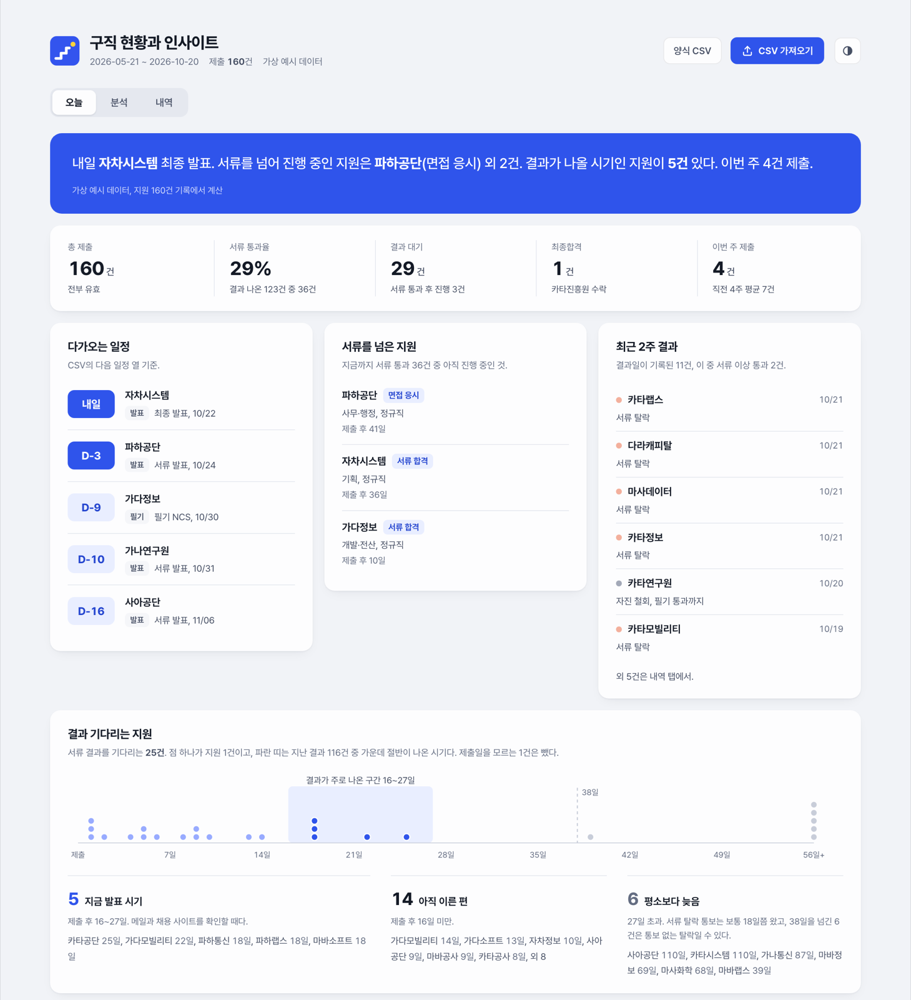

# Jobdash

지원 기록을 CSV로 넣으면 이번 주에 챙길 일과 서류가 잘 붙는 곳을 한 화면에 보여 주는 구직 대시보드입니다. 브라우저 안에서만 돌아갑니다. 넣은 데이터는 어디로도 보내지 않습니다.



화면의 회사와 숫자는 모두 지어낸 예시입니다.

## 바로 써 보기

- 온라인: https://yhpark-kr.github.io/jobdash/
- 내 컴퓨터: 이 저장소를 내려받아 `index.html`을 브라우저로 엽니다. 설치할 것은 없습니다.

처음 열면 예시 데이터가 보입니다. 날짜는 열 때마다 오늘에 맞춰 옮겨집니다.

## 내 기록 넣기

1. 오른쪽 위 `양식 CSV`를 눌러 양식을 받습니다.
2. 엑셀이나 구글 시트에서 예시 행을 지우고 내 지원 기록을 채웁니다.
3. CSV로 저장합니다.
4. `CSV 가져오기`를 눌러 그 파일을 고릅니다.

가져온 기록은 그 브라우저의 저장소에만 남습니다. 기록이 바뀌면 CSV를 고친 뒤 다시 가져오면 됩니다. 그러면 오늘 탭에 지난번과 달라진 점이 나옵니다. 브라우저 데이터를 지우면 함께 사라지니 원본 CSV는 따로 보관해 두세요. 엑셀 한국어판이 저장한 CSV(CP949)도 읽습니다.

### 열

| 열 | 필수 | 적는 법 |
|---|---|---|
| 회사 | 예 | 회사나 기관 이름 |
| 제출일 | 예 | `2026-10-21` 꼴. `2026/10/21`도 됩니다 |
| 기관유형 | | 대기업, 공공, 금융처럼 내가 나누고 싶은 대로 |
| 고용형태 | | 정규직, 전환형인턴 등 |
| 직무 | | AI·데이터, 개발·전산 등 |
| 결과일 | | 결과를 통보받은 날 |
| 결과 | | 비우면 진행중. 아래 표 참고 |
| 최고단계 | | 1 서류, 2 서류 합격, 3 필기 통과, 4 면접 응시, 5 최종 합격. 비우면 결과에서 짐작합니다 |
| 제출일추정 | | 제출일이 정확하지 않으면 `예`. 결과까지 걸린 날짜 계산에서 뺍니다 |
| 메모 | | 자유롭게. 필기 탈락은 메모에 `NCS`가 있으면 NCS, `코테`가 있으면 코테, 둘 다 없으면 기타로 나눠 셉니다 |
| 다음일정일 | | 다가오는 일정 날짜. `2026-10-28 14:00`처럼 시간도 적을 수 있습니다 |
| 다음일정 | | `1차 면접`, `필기 NCS`, `서류 발표` 같은 이름 |

결과 칸에는 다음 중 하나를 씁니다: 진행중, 서류 탈락, 필기 탈락, 인성검사 탈락, 면접 탈락, 최종합격, 합격 후 고사, 철회, 취소, 무응답.

형식이 틀린 행이 있으면 아무것도 저장하지 않고 몇 번째 행이 왜 틀렸는지 알려 줍니다.

## 화면

- **오늘**: 가장 가까운 일정과 지금 상황을 한 문단으로 요약합니다. 그 아래에 서류를 넘어 진행 중인 지원, 최근 2주 결과, 결과를 기다리는 지원, 묶음별 서류 통과율, 관문별 통과율, 주별 지원 페이스가 나옵니다.
- **분석**: 주별 지원량과 결과, 전형 단계별 깔때기, 탈락 단계, 월별 통과율 추세, 묶음별 통과율, 결과까지 걸린 날짜를 봅니다. 기관유형, 고용형태, 직무로 거를 수 있습니다.
- **내역**: 전체 기록 표입니다. 검색하고 결과로 거르고 열 제목으로 정렬합니다.

## 숫자를 세는 기준

- 서류 통과율의 분모는 서류 결과가 나온 지원뿐입니다. 아직 기다리는 지원은 넣지 않습니다.
- 취소는 통과율과 깔때기 계산에서 뺍니다(주별 지원량 차트에는 빗금으로 남습니다). 철회와 무응답은 결과가 나오지 않은 관문의 통과율 분모에서 뺍니다. 서류를 넘긴 뒤 철회한 지원은 서류 통과로 셉니다.
- 결과까지 걸린 날짜는 제출일과 결과일이 모두 정확한 지원만 씁니다.
- 결과 기다리는 지원의 파란 띠는 지난 결과 가운데 절반이 나온 구간(하위 25%∼75%)입니다. 이 구간을 넘기면 평소보다 늦은 것으로 봅니다. 하위 90% 선을 넘긴 건은 통보 없이 떨어졌을 수도 있다고 알려 줍니다. 이 구간은 제출일과 결과일이 정확한 결과가 5건 이상 쌓여야 계산합니다.
- 오늘 탭의 묶음별 통과율은 결과가 8건 이상 나온 묶음만 보여 줍니다. 분석 탭에서는 5건 미만 묶음을 흐리게 표시합니다. 몇 건 안 되는 묶음의 높은 비율에 끌려가지 않으려는 장치입니다.
- 분석 탭의 해석과 데이터 신뢰도는 필터와 관계없이 전체 기록으로 계산합니다.
- 모든 수치는 지금까지 관측한 값입니다. 왜 떨어졌는지를 말해 주지는 않습니다.

## 개발

```sh
node --test                    # CSV 읽기 테스트
python3 scripts/make_sample.py # 예시 데이터 다시 만들기
```

빌드 과정은 없습니다. `index.html`(화면), `csv.js`(CSV 읽기), `sample-data.js`(예시)가 전부입니다.

## 라이선스

코드는 [MIT](LICENSE)입니다. 함께 들어 있는 Pretendard 글꼴은 SIL Open Font License 1.1을 따릅니다([assets/fonts/Pretendard-LICENSE.txt](assets/fonts/Pretendard-LICENSE.txt)).
